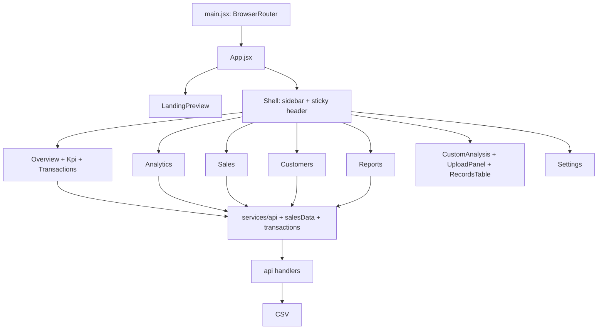

# Architecture

## Runtime

Client-rendered React 18 SPA bootstrapped by `src/main.jsx` under `BrowserRouter`. `src/App.jsx` chooses the landing page for `/`, `/welcome`, `/landing-preview.html`; otherwise it renders a persistent workspace shell and React Router routes. Unknown workspace paths render Overview. Vite builds static assets and hosts API handler middleware in dev/preview. On Vercel, `api/*.js` are serverless functions; `vercel.json` includes the CSV for those functions and rewrites paths to `index.html`.

## Component/data hierarchy

Data fetches are direct `fetch` calls through `src/services/api.js`; page components hold loading/error/data in `useState` and load once in `useEffect`. Aggregation/filtering runs in browser using `salesData.js`; charts render with Recharts. Generic uploaded data is parsed in-browser and stored in root `App` state only. Settings/date/theme use localStorage, not a global state library. No Redux/Context/query cache is installed.

## Error handling

API client rejects non-2xx responses, preferring JSON `error`; data pages show loading or retry card. Vite middleware catches exceptions and emits generic 500 JSON. Upload catches parser/validation errors and renders alert text. Settings catches storage failures and renders an alert. No app-wide error boundary or API cancellation/retry backoff is present.

## External systems

No external analytics service, database, auth provider, or third-party API is implemented. Dependencies are frontend/build libraries only. See [API docs](API_DOCUMENTATION.md) and [data flow](DATA_FLOW_DOCUMENTATION.md).
