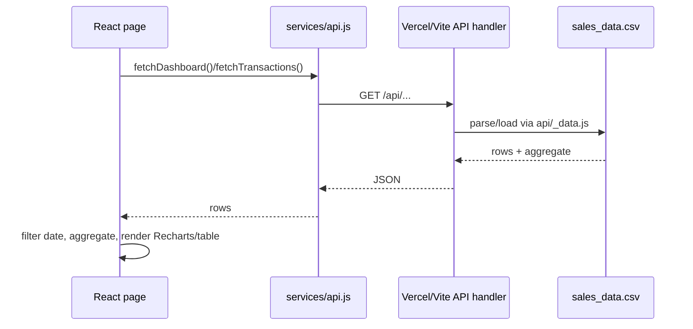

# Data flow

Handlers: `/api/dashboard` includes transactions and computed KPIs; `/api/transactions` returns rows; `/api/customers` returns segment aggregation. CSV upload takes a browser `File`, validates `.csv` and <=5 MiB, reads `file.text()`, parses generic table, and stores data in React state. It is not posted to API. Settings/theme/date range use browser localStorage. CSV downloads are generated client-side via Blob and object URL.

Potential source-based concern: the client effect loaders do not cancel stale requests or guard unmount; currently small static dataset reduces practical impact. Validate before altering.
