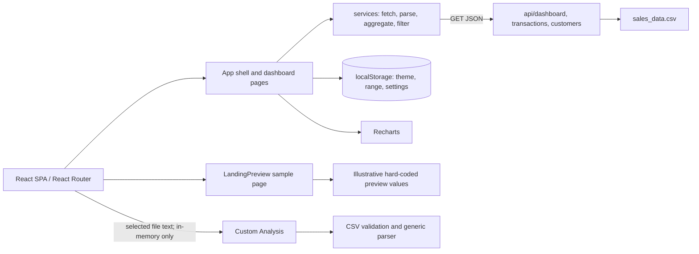

# InsightX Dashboard — Master Project Capsule

**Snapshot:** 2026-11-04 · branch `main` · HEAD `77311c7` (`Redesign InsightX landing page`) · worktree clean before capsule creation.

## Purpose and stack

InsightX is a React 18 sales analytics dashboard built with Vite 6, React Router 7, Recharts, Lucide React, Tailwind CSS 3, and Node's built-in test runner. Its current root experience is a designed marketing/interactive sample landing page. The app routes provide a dashboard workspace with six functional routes and a separate arbitrary CSV analysis tool. Deploy target configured in repository: Vercel. Public URL: https://insightx-dashboard-bice.vercel.app/ (not live-verified in this audit).

## Verified implementation

- Workspace routes: `/dashboard`, `/analytics`, `/sales`, `/customers`, `/reports`, `/custom-analysis`, `/settings`; `/`, `/welcome`, and `/landing-preview.html` render the landing preview. Unknown workspace paths fall back to Overview.
- Three public GET JSON endpoints read `sales_data.csv`; no auth or database. Vite middleware makes those endpoint handlers available in dev and preview; Vercel deploys `api/*.js` functions.
- Dataset has 1,000 sales rows, 13 months (Jan 2023–Jan 2024), INR values. Existing audit records ₹5,019,265.23 revenue and 25,355 units.
- Workspace filters, transaction search/sort/pagination/export, charts, reports, custom CSV analysis (in-memory, max 5 MB), settings, theme, notifications, support info, responsive navigation are implemented in source.
- Theme, workspace settings, and date range persist in browser `localStorage`; uploaded custom CSV does not persist or leave browser.
- Automated evidence this snapshot: `npm.cmd test` passed 23/23 Node tests and Vite production build. Build warns JS asset is 706.29 kB minified. `npm.cmd audit --omit=dev` failed due unavailable npm advisory endpoint, so vulnerability status is unknown for this snapshot.
- No browser automation dependency/config is present. A previous `docs/qa-audit.md` records browser checks on the older app state; its 2026-11-03 route matrix predates the landing-page redesign and does not verify the current root page or Custom Analysis browser interactions.

## Key files

- `src/App.jsx`: workspace shell, routes, data views, controls.
- `src/LandingPreview.jsx`, `src/landing.css`: root landing page and its interactive sample; decorative/demo data.
- `src/CustomAnalysis.jsx`: arbitrary CSV analysis UI.
- `src/services/`: API client, parsing/aggregation, table/report transforms, preferences, upload validation.
- `api/`: Vercel handlers and shared CSV-backed data loading.
- `sales_data.csv`: mock dataset; do not expose as static asset.
- `tests/`: six Node test files; no UI/browser tests.
- `docs/qa-audit.md`: prior QA report, historical not fully current.

## Mermaid architecture

## Working habits and known constraints

Inspect existing code before edits. Keep custom-upload records isolated from the workspace dataset. Label landing preview metrics as illustrative. Preserve no-auth/public-read-only API assumptions unless intentionally redesigned. Future agents must update this capsule after major changes. See [current status](CURRENT_STATUS.md), [task tracker](TASK_TRACKER.md), and [latest handoff](handoffs/LATEST_HANDOFF.md).
