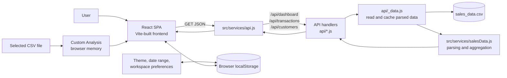
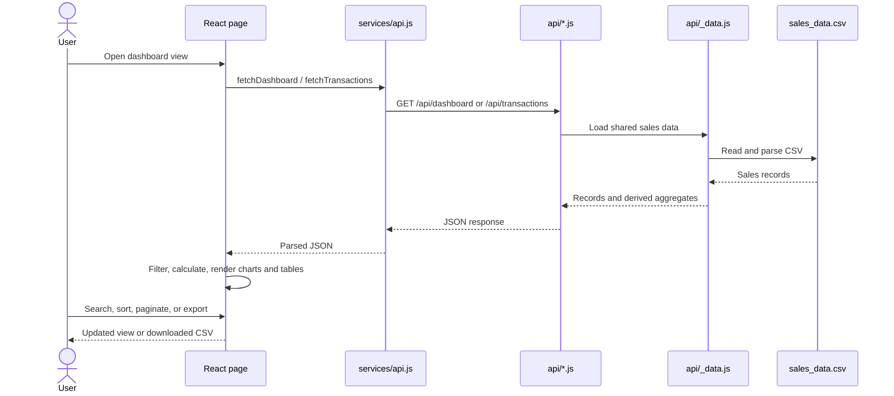
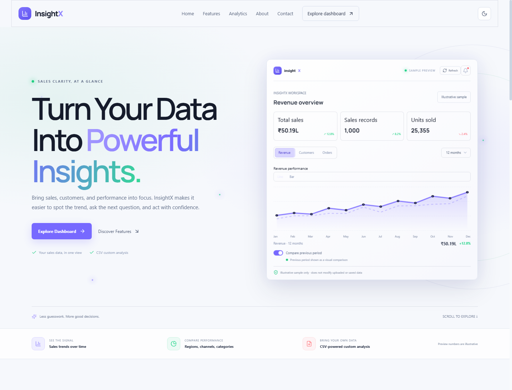
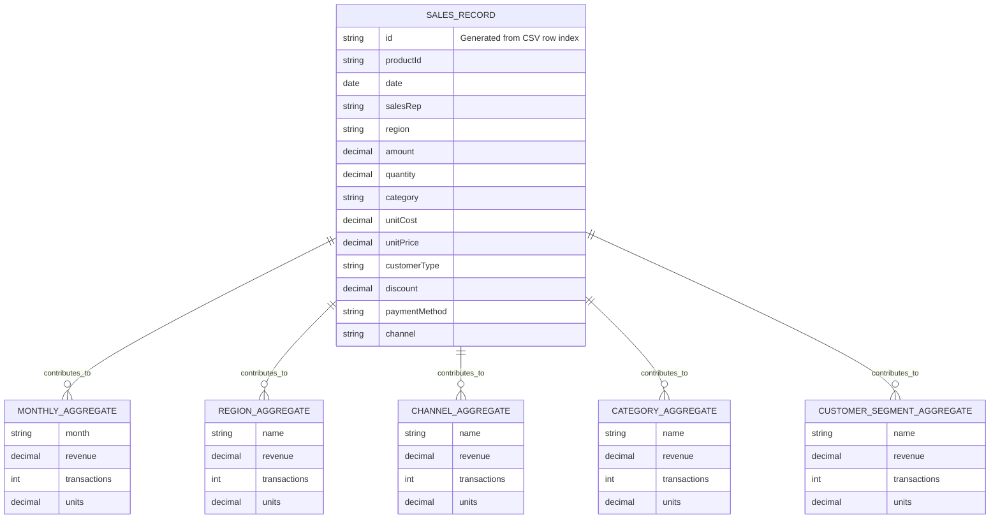

<div align="center">
  
  <h1>InsightX</h1>
  <p><strong>Revenue intelligence for exploring sales data.</strong></p>
  <p>A responsive React dashboard for inspecting revenue, transactions, customer segments, and custom CSV datasets.</p>
  <p>
    <a href="https://github.com/trishank18/insightx-dashboard"></a>
    <a href="https://insightx-dashboard-bice.vercel.app/"></a>
    
    
    
    
  </p>
</div>

---

## Contents

- [Overview](#overview)
- [Features](#features)
- [Technology stack](#technology-stack)
- [Architecture](#architecture)
- [Application workflow](#application-workflow)
- [Screenshots](#screenshots)
- [Project structure](#project-structure)
- [Getting started](#getting-started)
- [Configuration and data](#configuration-and-data)
- [API reference](#api-reference)
- [Data model](#data-model)
- [Commands](#commands)
- [Testing](#testing)
- [Security](#security)
- [Deployment](#deployment)
- [Troubleshooting](#troubleshooting)
- [Roadmap](#roadmap)
- [Contributing](#contributing)
- [License and author](#license-and-author)

---

## Overview

**InsightX** is a sales analytics dashboard built around a bundled sample CSV dataset. It turns sales records into summary metrics, time-series charts, channel and regional comparisons, customer-segment summaries, searchable transaction tables, and downloadable CSV reports. A separate Custom Analysis view lets users inspect their own CSV files locally in the browser.

### Problem and solution

Raw sales exports are difficult to scan and compare. InsightX provides a visual workspace that parses a consistent sales dataset, calculates key measures, and presents the results in focused views. Its custom analysis feature also supports exploratory analysis of arbitrary tabular CSV files without uploading them to the API.

### Objectives

- Make sales trends and transaction details easy to explore.
- Keep dashboard measures consistent across date-filtered views.
- Offer exportable transaction and report data.
- Demonstrate a small React frontend connected to serverless-style, read-only data endpoints.
- Provide an isolated, browser-side CSV analysis workflow.

### Target users and applications

The project is suitable as a portfolio demonstration and as a starting point for developers exploring dashboard UI patterns, CSV parsing, data aggregation, charts, and lightweight API handlers. Example uses include sales review, regional and channel comparisons, customer-segment summaries, and quick analysis of a local CSV export.

### Status

A functional demo with a bundled sample dataset. API handlers and Vercel deployment configuration are present. The repository does not establish that a production deployment is currently available or healthy.

---

## Features

| Area | What it provides | Data source / behavior |
| --- | --- | --- |
| Overview | Revenue, record count, units, average order, monthly revenue chart, channel mix, and transaction table | Read-only dashboard API; date range and calculations in the client |
| Analytics | Sales trends and breakdown charts | Aggregations derived from the sample sales records |
| Sales | Searchable, sortable, paginated transaction records and CSV export | Read-only transaction data |
| Customers | New vs. Returning segment metrics | Aggregated from the `Customer_Type` field; no individual customer profiles |
| Reports | Monthly revenue, customer segment, and sales channel CSV exports | Generated in the browser |
| Custom Analysis | Upload and explore arbitrary CSV columns with inferred basic column types | File is read and analyzed in browser memory; not sent to API |
| Settings | Workspace name, supported timezone, and weekly digest preference | Browser `localStorage`; no server-side account settings |
| Appearance | Responsive navigation and light/dark theme | Theme preference stored in browser `localStorage` |

---

## Technology stack

| Category | Technologies | Usage |
| --- | --- | --- |
| Language | JavaScript (ES modules), JSX, HTML, CSS | Application, API handlers, and styles |
| Frontend | React 18, React DOM, React Router 7 | UI composition and client-side routes |
| Charts and icons | Recharts, Lucide React | Visualizations and interface icons |
| Styling | Tailwind CSS 3, PostCSS, Autoprefixer | Utility styling and CSS processing |
| Build and local server | Vite 6, `@vitejs/plugin-react` | Development server, production build, preview, and local API middleware |
| API runtime | Node.js ES modules; Vercel Functions-compatible handlers | Read-only JSON endpoints backed by a CSV file |
| Data | CSV file and in-memory JavaScript aggregation | No SQL/NoSQL database is configured |
| Tests | Node.js built-in test runner (`node:test`) | Unit and handler/client behavior tests |
| Deployment configuration | Vercel configuration | Function file inclusion and SPA rewrite rules |

Unused package dependencies are not documented as active features. Although packages for MySQL, Express, authentication, email, payments, and validation appear in `package.json`, the inspected application code does not use them in its implemented flows.

---

## Architecture

### System view



In local development and preview, `vite.config.js` installs middleware that dispatches the same three handlers. On Vercel, files under `api/` are configured as functions, and `vercel.json` includes `sales_data.csv` with those functions. The SPA rewrite sends unmatched paths to `index.html`.

### Frontend architecture

`src/main.jsx` mounts the React application. `src/App.jsx` contains the workspace shell, route definitions, dashboard views, and shared UI behavior. Feature-specific CSV analysis is in `src/CustomAnalysis.jsx`; `src/LandingPreview.jsx` provides the landing/demo preview. Service modules under `src/services/` isolate fetching, parsing, aggregation, preferences, filtering, and CSV export logic.

### Backend and API communication

The `api/*.js` modules are small asynchronous GET handlers. Shared data loading and caching live in `api/_data.js`, which reads `sales_data.csv` and delegates parsing and aggregation to `src/services/salesData.js`. The frontend calls same-origin paths through `src/services/api.js`. There is no separate Express server in the active startup scripts.

### Database, authentication, and integrations

There is **no database schema or database connection** in the implemented application. The dashboard dataset is a checked-in CSV file, and browser preferences use `localStorage`. There are no registration/login flows, user roles, session management, external service calls, payment/email integrations, or machine-learning model integration in the application code. The API endpoints are public and read-only.

### Deployment architecture

The repository contains Vercel function and rewrite configuration, but deployment is not verified by repository contents alone. See [Deployment](#deployment) for the configuration-based setup outline.

---

## Application workflow

### Dashboard data workflow

1. The browser loads the Vite-built React application and route shell.
2. A dashboard view calls a loader in `src/services/api.js`.
3. The client sends a same-origin `GET` request to the relevant `/api/...` endpoint.
4. The handler in `api/` requests shared data from `api/_data.js`.
5. `_data.js` reads and parses `sales_data.csv`; its promise is retained for reuse within the function instance.
6. The handler returns records, KPI aggregates, or customer segments as JSON.
7. The page applies requested date filters and renders metrics, charts, or tables.
8. Search, sorting, pagination, and CSV exports run in the browser.



### Custom CSV workflow

The user selects a `.csv` file up to 5 MiB. The browser reads it using the File API, validates/parses its contents, infers column types, and holds the result in React state for the Custom Analysis view. Clearing the upload removes that in-memory analysis state. The file is not posted to the backend and is not persisted by the app.

### Preferences workflow

Theme, date range, and settings are stored in browser `localStorage`. They are local to the browser profile; they are not attached to an account or synchronized to a server. There are no separate role workflows, registration, login, or logout flows.

---

## Screenshots

These images are present in `docs/screenshots/` and are embedded directly from the repository.

**Landing page** — the application landing experience with its live dashboard preview and navigation.

<p align="center"></p>

| Overview dashboard | Analytics view |
| --- | --- |
| **Overview** — KPI cards, revenue trend, and transaction workspace. | **Analytics** — visual sales breakdowns and performance metrics. |
|  |  |

**Mobile layout** — responsive dashboard presentation at a narrow viewport.

<p align="center"></p>

### Recommended screenshots to add

The repository currently has no verified screenshots dedicated to Custom Analysis upload/results, Reports export controls, Customers page, or Settings page. Capture those views from the running application before adding them; do not use mockups as application screenshots.

---

## Project structure

```text
insightx-dashboard/
├── api/
│   ├── _data.js                 # Shared CSV loading, caching, and data access
│   ├── customers.js             # GET customer segment endpoint
│   ├── dashboard.js             # GET dashboard data and KPI endpoint
│   └── transactions.js          # GET transaction collection endpoint
├── docs/
│   ├── screenshots/             # Verified overview, analytics, and mobile screenshots
│   ├── qa-audit.md              # Repository QA notes
│   └── wireframes.md            # UI layout and design notes
├── public/
│   └── favicon.svg              # Static browser icon and README mark
├── src/
│   ├── services/
│   │   ├── api.js               # Same-origin JSON API client
│   │   ├── csvUpload.js         # CSV upload validation and parsing adapters
│   │   ├── preferences.js       # Settings validation and localStorage persistence
│   │   ├── salesData.js         # CSV parsing, date filtering, and aggregations
│   │   └── transactions.js      # Search, sorting, paging, and CSV export helpers
│   ├── App.jsx                  # Workspace shell, routes, dashboard views
│   ├── CustomAnalysis.jsx       # Custom CSV analysis interface
│   ├── LandingPreview.jsx       # Landing/demo preview interface
│   ├── index.css                # Shared application styles
│   ├── landing.css              # Landing preview styles
│   └── main.jsx                 # React application entry point
├── tests/                       # Node built-in test suites
├── INSIGHTX_AI_CAPSULE/         # Project notes and implementation documentation
├── sales_data.csv               # Bundled sample sales source data
├── index.html                   # Vite HTML entry document
├── landing-preview.html         # Additional landing preview HTML document
├── package.json                # Scripts and dependencies
├── package-lock.json           # Locked dependency versions
├── postcss.config.js           # PostCSS plugins
├── tailwind.config.js          # Tailwind theme and content configuration
├── vercel.json                 # Vercel function and SPA routing configuration
└── vite.config.js               # Vite, React plugin, and local API middleware
```

`dist/` is generated build output and `node_modules/` is installed dependency content; neither is source code. `.tmp-edge/` is a local temporary directory and is omitted from the project documentation tree.

---

## Getting started

### Requirements

- Node.js with ES module and built-in test-runner support (Node 18 or newer is a practical baseline).
- npm, which is distributed with Node.js.
- Git to clone the repository.
- No database installation, API account, or credentials are needed for the checked-in demo.

The repository does not declare an `engines` field, so an exact supported Node version is not pinned.

### Install and run

```bash
git clone https://github.com/trishank18/insightx-dashboard.git
cd insightx-dashboard
npm install
npm run dev
```

Vite uses its standard development-server defaults because no custom host or port is specified. Check the terminal output for the exact local URL, especially if the default port is occupied.

### Build and preview

```bash
npm run build
npm run preview
```

The preview server serves the production build and the Vite configuration also attaches the local API middleware. The terminal prints the preview URL.

---

## Configuration and data

### Environment variables

No environment variables are read by the implemented application code, and no `.env.example` is needed. Do not add credentials for unused dependencies as though they were required configuration.

### Bundled sales data

`sales_data.csv` is the source data for the API. It contains 1,000 records spanning January 2023 through January 2024. The parser expects a header row with aliases for these fields:

`Product_ID`, `Sale_Date`, `Sales_Rep`, `Region`, `Sales_Amount`, `Quantity_Sold`, `Product_Category`, `Unit_Cost`, `Unit_Price`, `Customer_Type`, `Discount`, `Payment_Method`, and `Sales_Channel`.

Dates must use `YYYY-MM-DD`; numeric fields must parse as finite numbers. The source is parsed at runtime by the API data loader. There is no SQL import, database creation, schema migration, or seed command.

Custom Analysis accepts arbitrary headers and rows, while the sales-specific upload parser requires the sales fields above. Both enforce a `.csv` filename and a maximum size of 5 MiB.

---

## API reference

All implemented endpoints are same-origin, public, read-only `GET` routes. They require no authentication and accept no query parameters or request body. Other methods return `405 Method Not Allowed` with `Allow: GET`. Successful responses are JSON; read/parse failures return `500` with a generic error message. The API client throws an error on non-2xx responses and uses the JSON `error` value when available.

| Endpoint | Method | Purpose | Success response |
| --- | --- | --- | --- |
| `/api/dashboard` | `GET` | Transaction rows plus computed KPI and chart aggregates | `{ "transactions": [...], "kpis": { ... } }` |
| `/api/transactions` | `GET` | All parsed sales transaction rows | `[...]` |
| `/api/customers` | `GET` | Aggregated customer-type segments | `[{ "name": "New", ... }, { "name": "Returning", ... }]` |

Example request:

```bash
curl -i http://localhost:5173/api/dashboard
```

The port above is Vite's default only; use the actual address printed by the local server if it differs.

Example dashboard response shape (abbreviated):

```json
{
  "transactions": [
    {
      "id": "SALE-00001",
      "productId": "...",
      "salesRep": "...",
      "region": "...",
      "amount": 5053.97,
      "quantity": 18,
      "customerType": "Returning",
      "date": "2023-02-03"
    }
  ],
  "kpis": {
    "revenue": 5019265.23,
    "transactionCount": 1000,
    "units": 25355,
    "averageOrder": 5019.27,
    "monthlySales": [],
    "channels": [],
    "regions": [],
    "categories": [],
    "customerSegments": []
  }
}
```

The abbreviated KPI values illustrate the checked-in dataset; arrays are shortened to avoid duplicating the dataset. No API writes, file upload endpoint, or third-party API calls are implemented.

---

## Data model

There is no relational or document database and therefore no persisted database schema, primary keys, foreign keys, or database relationships. The API parses CSV rows into in-memory transaction objects and computes aggregate views. The `id` value (`SALE-00001`, etc.) is generated from the row position during parsing; it is not a durable database key.

The following diagram describes the **logical data shape**, not database tables:



The aggregate nodes are calculated values in the API response, not stored entities. Customer records are grouped only by `Customer_Type`; the dataset does not provide an individual customer identifier or profile.

---

## Commands

| Command | Purpose |
| --- | --- |
| `npm install` | Install locked project dependencies |
| `npm run dev` | Start Vite development server and local API middleware |
| `npm run build` | Create production frontend output in `dist/` |
| `npm run preview` | Serve the built app locally with Vite preview and API middleware |
| `npm test` | Run Node tests, then build the frontend |
| `node --test` | Run Node test files without the build step |

There are no separate frontend/backend/database startup commands: the Vite server serves the frontend and local API handlers together, and the sample dataset is a file.

---

## Testing

The repository uses Node's built-in test runner. Test coverage includes CSV parsing and aggregation, API handler response/method behavior, API client error handling, custom CSV validation, preference persistence, transaction filtering/sorting/pagination, and CSV report schemas.

```bash
npm test
```

This command runs `node --test` and then `npm run build`. To run only the test suites:

```bash
node --test
```

No dedicated unit/integration framework, API test client, database test suite, or browser automation configuration is present. The handlers can also be inspected through the local endpoints while Vite is running. No test results are asserted here; run the commands in your environment to verify the current checkout.

---

## Security

### Implemented behavior

- API handlers allow only `GET` and reject other methods with `405`.
- API error responses use generic messages rather than exposing filesystem or parser error details.
- CSV parsing validates required fields, date formats, numeric values, and file size/type for browser uploads.
- Custom Analysis reads the selected file locally and does not send it to the API.
- No passwords, credentials, account sessions, or server-side user data are implemented.

### Scope and operational notes

The data endpoints are public and have no authentication or authorization. The checked-in sample CSV is therefore served through the API as demo data; do not replace it with confidential data in a public deployment. Since there is no database, SQL injection protection and password hashing are not applicable to the current implementation. Keep future secrets in deployment environment configuration, never in source control, if external services are added.

---

## Deployment

`vercel.json` configures `api/*.js` as functions, includes `sales_data.csv` in each function bundle, and rewrites unmatched routes to `index.html`. This is deployment configuration, not evidence of a completed or currently operational deployment.

For a Vercel deployment:

1. Import the Git repository into a Vercel project.
2. Use the repository root as the project root.
3. Use the Vite build command `npm run build` and output directory `dist` if the project setup asks for them; the checked-in configuration does not declare a deployment status.
4. Confirm that the function bundle includes `sales_data.csv` (the repository config requests this).
5. After deployment, verify the app routes and `/api/dashboard`, `/api/transactions`, and `/api/customers` endpoints.

No environment variables or database services are required by the current source. Other providers may require adapting the `api/` function conventions and SPA routing to their runtime; they are not configured in this repository.

---

## Troubleshooting

| Symptom | Likely cause | What to check |
| --- | --- | --- |
| `npm` commands are unavailable | Node.js/npm is missing or the shell resolves a restricted script shim | Install Node.js LTS; on PowerShell, `npm.cmd` can invoke npm when `npm.ps1` execution is blocked |
| Vite reports the port is in use | Another process is listening on the default port | Use the alternate URL printed by Vite, or stop the process using that port |
| Dashboard shows a data error | API middleware/function failed or the CSV could not be read/parsed | Inspect the server terminal and request `/api/dashboard`; check the required CSV headers and date/number formats |
| API returns `405` | A method other than `GET` was used | These endpoints are intentionally read-only |
| CSV upload is rejected | Wrong extension, file larger than 5 MiB, empty/malformed content, or missing required sales columns | Use a `.csv` file within the size limit; sales CSV upload requires the documented columns, while Custom Analysis accepts arbitrary headers |
| A preference appears reset | Browser storage is unavailable/cleared, or the preference is being viewed in another browser profile | Check browser `localStorage`; preferences are client-local and are not synchronized |
| Database connection fails | No database connection is part of the implemented project | No database service or connection string is required for the current demo |

---

## Roadmap

Possible next steps that build on the current implementation:

- Add dedicated screenshots for Custom Analysis, reports, customer segments, and settings.
- Add browser-level interaction and accessibility checks.
- Add configurable dataset selection or a supported persistent storage layer if multi-user data is needed.
- Add authentication and authorization only alongside a server-side identity and data ownership model.
- Add API pagination/filter parameters if the dataset grows beyond a bundled demo file.
- Improve production bundle splitting if the dashboard expands.

These are suggestions; they are not implemented features.

---

## Contributing

Contributions are welcome through the repository's normal GitHub workflow:

1. Fork the repository.
2. Create a focused branch: `git switch -c feature/your-change`.
3. Install dependencies and make the change.
4. Run `npm test` and review the resulting build.
5. Commit with a clear message: `git commit -m "Describe your change"`.
6. Push your branch and open a pull request against the upstream repository.
7. Use GitHub Issues to report bugs or propose improvements, including reproduction steps where possible.

---

## License and author

Released under the [MIT License](LICENSE). The license file names **Subramanya Trishank Reddy Mukkamalla** as copyright holder.

- **Repository:** [github.com/trishank18/insightx-dashboard](https://github.com/trishank18/insightx-dashboard)
- **Live demo:** [insightx-dashboard-bice.vercel.app](https://insightx-dashboard-bice.vercel.app/)
- **Author:** Subramanya Trishank Reddy Mukkamalla


