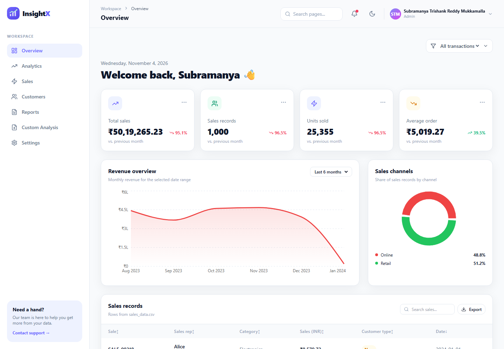
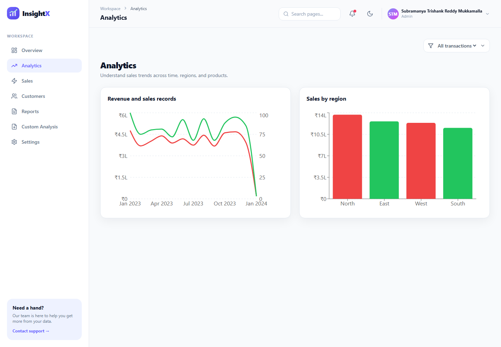
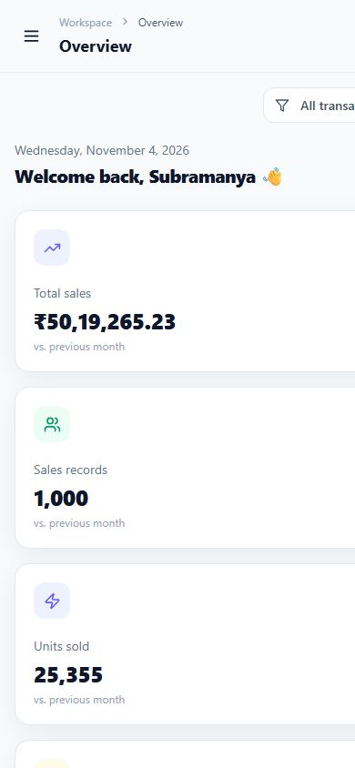

# InsightX Dashboard

InsightX is a responsive analytics dashboard for **Problem Statement 02: Interactive Analytics Dashboard UI**. It brings sales, customer, and performance metrics together in one workspace.

## Features and modules

| Requirement | Implementation |
| --- | --- |
| Sidebar, top bar, and summary cards | Shared shell, navigation, and KPI cards |
| At least three chart types | Recharts area, line, bar, and donut charts |
| Searchable, sortable table with pagination | Overview transaction table |
| Light and dark themes | Top-bar toggle persisted in browser storage |
| Data loading and error states | Async CSV loading, loading indicators, and retry actions |
| Custom CSV analysis | Isolated Custom Analysis page with upload validation, KPIs, charts, search, pagination, and export |
| Reports | Separate monthly revenue, customer segment, and sales channel CSV exports |
| Workspace settings | Validated name, timezone, weekly digest, and local persistence |

## Project structure

```text
src/
  App.jsx                    Routes, layout, pages, charts, controls
  CustomAnalysis.jsx         Isolated analysis of a user-uploaded CSV
  main.jsx                   React entry point and router
  index.css                  Tailwind styles and design tokens
  services/
    api.js                   Asynchronous sales CSV data service
    preferences.js           Settings validation and persistence
    transactions.js          Search, sorting, pagination, and CSV reports
    salesData.js             CSV parsing and sales aggregations
tests/                       Node feature and edge-case tests
docs/                         Wireframes, screenshots, and QA audit
```

## Stack and setup

- Node.js 20 or newer and npm
- React 18, Vite 6, and React Router 7
- Recharts, Lucide React, Tailwind CSS 3, PostCSS, and Autoprefixer
- Git

Install dependencies and start the development server:

```bash
npm install
npm run dev
```

Create and preview a production build:

```bash
npm run build
npm run preview
```

Run the automated feature tests and production build check:

```bash
npm test
```

Check installed dependencies for published advisories:

```bash
npm audit
```

## Data and assumptions

The existing Overview, Analytics, Sales, Customers, and Reports pages continue to load their original workspace data from the read-only JSON API backed by `sales_data.csv`: `GET /api/dashboard`, `GET /api/transactions`, and `GET /api/customers`. Those endpoints run as Vercel serverless functions and as Vite middleware during development and preview.

Use the separate **Custom Analysis** sidebar page to analyze any user-provided CSV without changing the existing workspace pages. No preset column names are required: the CSV needs a header row and at least one data row, and files must be no larger than 5 MB. The page infers numeric, date, and text columns, then creates summaries, charts, and searchable/paginated transaction rows only from the uploaded file. Imported data stays in browser memory for the current session; it is not sent to the API or saved after refresh. Choose **Clear uploaded data** to remove it.

The CSV does not contain individual customer identities, so the Customers route reports New and Returning customer segments instead of inventing names or contact details. Monetary values are displayed and labeled in Indian rupees (INR). The shared date-range control filters Overview, Analytics, Sales, Customers, and report exports locally, and the selected range persists in `localStorage`. The settings form stores preferences in `localStorage`. This is a public read-only demo API and does not include authentication, user accounts, or server-side settings sync.

## UI/UX design

The interface uses persistent desktop navigation, a sticky top bar, KPI cards, chart panels, and a transaction table. On small screens the sidebar becomes a drawer, card grids collapse, and wide tables scroll inside their panels. Colors use slate surfaces and borders, indigo actions, green positive states, and amber/rose attention states. System UI sans-serif typography is used throughout.

See [docs/wireframes.md](docs/wireframes.md) for the layout sketch and responsive notes.

## Tests and QA

`npm test` covers CSV parsing and validation, sales aggregation, settings validation and persistence, table search/sort/pagination edge cases, CSV escaping, distinct report schemas, and monthly aggregation; it then verifies the Vite production build.

The end-to-end audit report records the browser checks, responsive route matrix, dependency scan, fixes, and the functionality that cannot be exercised without a real backend: [docs/qa-audit.md](docs/qa-audit.md).

## Screenshots

Screenshots refreshed on 2026-11-04 from the local Vite production preview.

### Desktop Overview (1440 × 1000)



### Desktop Analytics (1440 × 1000)



### Mobile Overview (390 × 844)



## Routes

- `/` — Sales KPIs, monthly revenue chart, sales-channel donut, and sales records
- `/analytics` — revenue and sales-record trends plus regional comparisons
- `/sales` — sales KPIs and funnel
- `/customers` — new and returning customer segments
- `/reports` — three distinct CSV exports
- `/custom-analysis` — isolated analysis built only from a user-uploaded CSV
- `/settings` — workspace preferences


The configured GitHub remote is `https://github.com/trishank18/insightx-dashboard.git`. Use `git remote -v` to inspect it and `git push` to publish commits.
